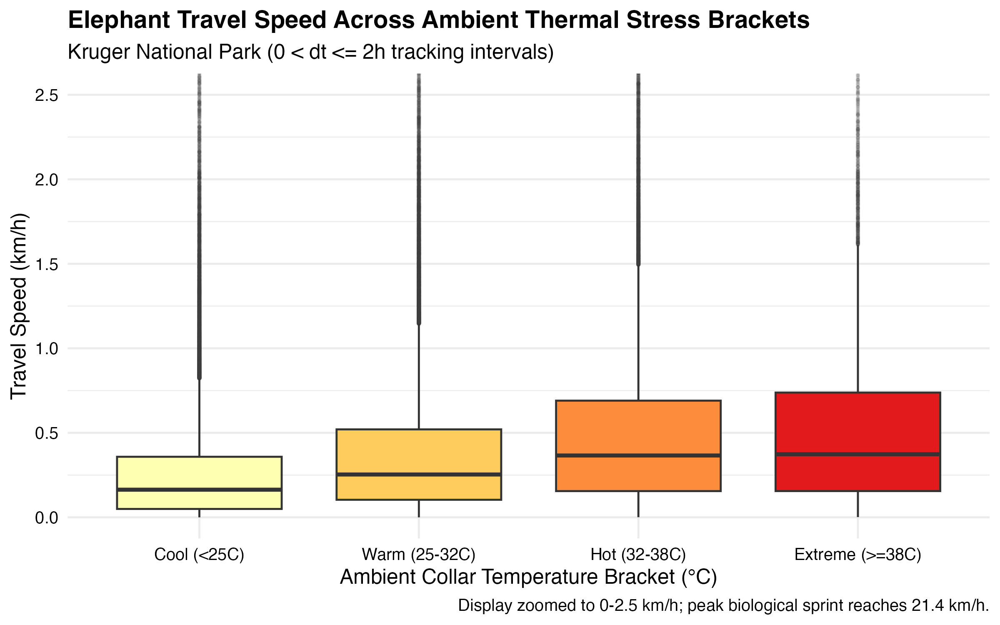
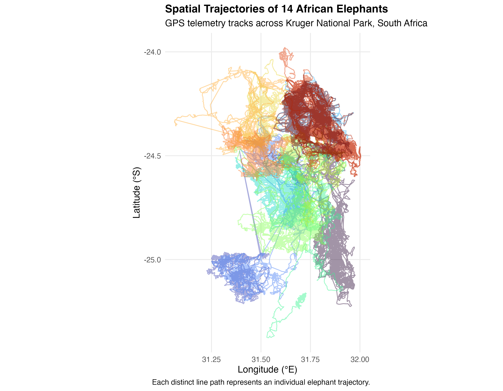

# Thermal Ecology & Shuttling Behavior of African Elephants in Kruger National Park

An exploratory spatial and time-series analysis investigating how ambient temperature drives movement velocity and spatial trajectories of free-ranging African elephants (*Loxodonta africana*) in Kruger National Park, South Africa.

## Overview & Ecological Question
Large terrestrial herbivores face severe thermoregulatory challenges in semi-arid savannas. When ambient temperatures approach or exceed core body temperature (~36–37°C), do elephants reduce activity to conserve energy (thermal lethargy), or do they accelerate movement to traverse exposed terrain toward water and shade refuges ("shuttling" behavior)?

Using fine-scale GPS telemetry paired with collar-mounted temperature sensors, this project quantifies displacement metrics across thermal stress gradients to evaluate behavioral thermoregulation.

---

## Key Visualizations

### 1. Travel Speed Across Thermal Stress Brackets

### 2. Individual Movement Trajectories Across Kruger National Park

---

## Key Findings
* **Accelerated Movement Under Extreme Heat:** Median travel speed increases monotonically with ambient temperature, rising **+128%** from `0.164 km/h` during cool conditions (`<25°C`) to `0.373 km/h` during extreme heat (`>=38°C`).
* **Statistical Significance:** A non-parametric Kruskal-Wallis rank sum test confirmed highly significant velocity differences across thermal categories ($\chi^2 = 17,183.76$, $\text{df} = 3$, $p < 0.001$).
* **Evidence of Shuttling Behavior:** Rather than entering prolonged thermal stasis, elephants exhibit bimodal movement under extreme heat—combining stationary rest near microclimatic refuges with rapid, directed transit corridors across open savanna.
* **Biological Integrity:** Filtering sampling intervals to $0 < \Delta t \le 2\text{ hours}$ retained >97.4% of telemetry fixes (276,440 valid steps) while eliminating multi-day sensor gaps and bounding peak sprint velocities at `21.4 km/h` (`5.94 m/s`).

---

## Methodology & Pipeline
1. **Data Hygiene & Temporal Parsing:** Processed `283,688` raw GPS telemetry records across `14` individual elephants (`POSIXct` timestamp standardization and gap diagnostics).
2. **Geospatial Step Calculations:** Computed great-circle step lengths (meters) via the Haversine formula (`geosphere`) and derived standardized velocities (`km/h` and `m/s`).
3. **Thermal Categorization:** Partitioned ambient collar temperatures into four physiological brackets: Cool (`<25°C`), Warm (`25–32°C`), Hot (`32–38°C`), and Extreme (`>=38°C`).
4. **Statistical & Spatial Modeling:** Evaluated skewed speed distributions via Kruskal-Wallis testing and mapped regional home ranges and transit corridors.

---

## Tools & Data Source
* **Language & Libraries:** R (`ggplot2`, `geosphere`, `sp`, `knitr`)
* **Dataset:** Movebank Data Repository — *Fine-scale tracking of ambient temperature and movement reveals shuttling behavior of elephants to water* (Slotow, Thaker, & Vanak, 2019).
